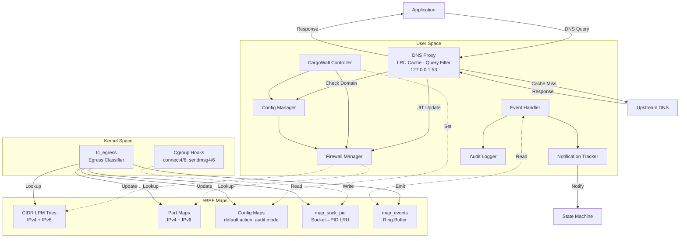
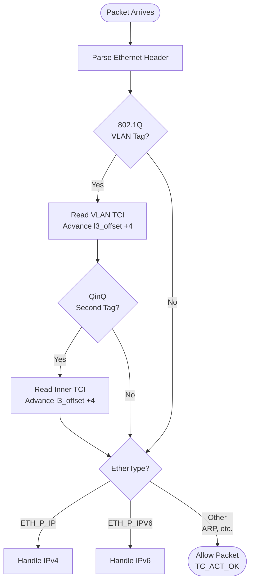
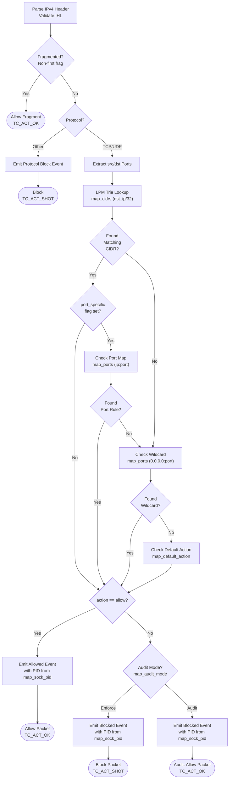
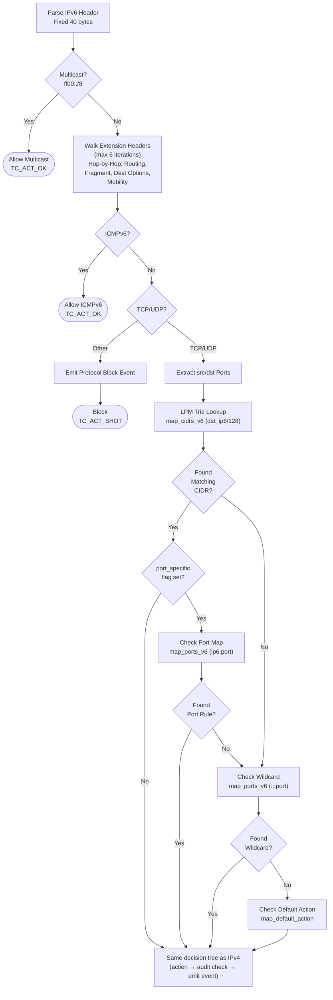
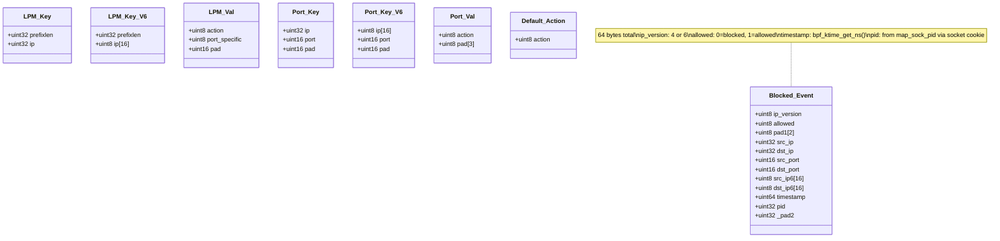
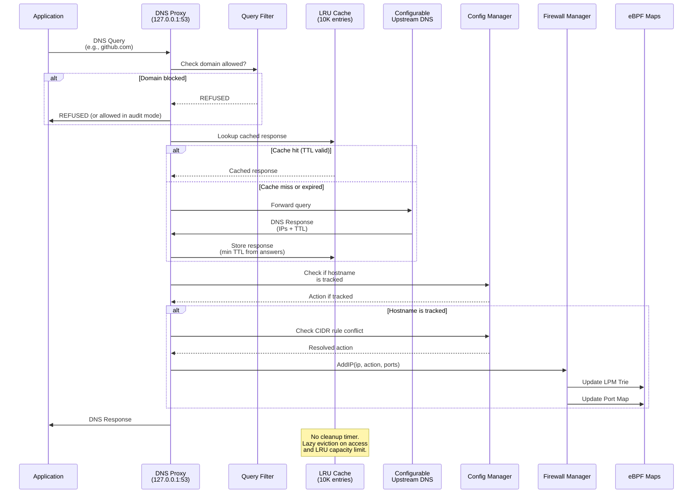

# Design

Dual-stack (IPv4/IPv6) egress firewall using TC eBPF filtering and a cgroup_skb hook for the L3/L4 verdict, an optional L7 layer that pins the TLS SNI / HTTP Host / QUIC name of flows to shared edge IPs (see "L7 destination-identity enforcement"), cgroup socket hooks for PID tracking, an integrated DNS proxy for JIT hostname resolution, and an audit mode for log-only operation.

## Key Features

- **Dual-Stack L4 Firewall**: Filters TCP and UDP traffic on both IPv4 and IPv6
- **Protocol Handling**: Blocks non-TCP/UDP on IPv4; allows ICMPv6 and IPv6 multicast (`ff00::/8`); passes non-IP traffic (ARP)
- **DNS Proxy with JIT Resolution**: Intercepts DNS queries and updates firewall rules in real-time
- **Hostname Glob Patterns**: `*` (one label) and `**` (one or more labels) wildcards for matching dynamic hostnames
- **DNS Query Filtering**: Blocks queries for non-allowed domains to prevent DNS tunneling
- **Port-Specific Rules**: Granular port-based filtering including wildcard CIDRs (`0.0.0.0/0`, `::/0`)
- **LPM Trie Optimization**: Separate IPv4 and IPv6 longest-prefix-match tries for efficient CIDR lookups
- **Process/PID Tracking**: Cgroup socket hooks map socket cookies to PIDs for per-process attribution
- **Audit Mode**: Log-only mode — events are emitted but traffic is never dropped
- **Audit Logging**: NDJSON log file with structured event records
- **Real-time Monitoring**: Ring buffer event stream with notification deduplication via state machine
- **DNS LRU Cache**: 10,000-entry cache with lazy TTL eviction
- **VLAN Support**: Handles 802.1Q and QinQ (802.1ad) tagged frames
- **Docker Integration**: Listens on bridge IP, configures daemon DNS
- **GitHub Actions Integration**: Auto-infrastructure discovery, iptables DNS redirect, sudo lockdown
- **Kubernetes Integration**: Search domain stripping, configurable upstream DNS

## Architecture Overview



## Packet Processing Flow (eBPF TC Egress)

### Main Dispatch



### IPv4 Path



### IPv6 Path



## eBPF Map Data Structures



## DNS Proxy JIT Resolution Flow



## Component Responsibilities

### Firewall Manager (`pkg/firewall`)
- Manages 8 eBPF maps: `map_cidrs`, `map_cidrs_v6`, `map_ports`, `map_ports_v6`, `map_default_action`, `map_audit_mode`, `map_events`, `map_sock_pid`
- Separate IPv4/IPv6 methods (`addCIDRv4`, `addCIDRv6`) with appropriate key types
- `SetDefaultAction(action)` — sets `map_default_action[0]` to 0 (deny) or 1 (allow)
- `SetAuditMode(enabled)` — sets `map_audit_mode[0]` to 0 (enforce) or 1 (audit)
- `AddIP(ip, action, ports)` — adds /32 or /128 entry with duplicate detection; returns whether entry was added
- `RemoveIP(ip)` — removes LPM entry and all associated port map entries
- Wildcard CIDR handling: `0.0.0.0/0` and `::/0` with specific ports add only port map entries (no LPM entry)
- Tracks IP-to-port associations (`ipPorts` map) for accurate cleanup on removal
- Thread-safe with `sync.RWMutex`

### DNS Proxy Server (`pkg/dns`)
- Primary listen address `127.0.0.1:53`, with additional addresses (e.g., Docker bridge IP) via `AddListenAddr()`
- Configurable upstream DNS (e.g., `10.96.0.10:53` for Kubernetes)
- LRU cache (10,000 entries) with per-entry TTL from DNS response minimum TTL
- DNS query filtering (`EnableQueryFiltering`) — blocks queries for non-allowed domains; always allows reverse DNS (`in-addr.arpa`, `ip6.arpa`). CNAME targets seen in an allowed response are learned (TTL-bounded, 10,000-entry LRU), each carrying the origin rule's allow ports (UNIONed across origins via `config.UnionPorts`). A learned target is both permitted for later direct queries and, when one resolves, has its IPs written to the allow map on the inherited ports — so a chain split across query round-trips (CDN-fronted PKI that returns a different Akamai/Cloudflare variant per query, dynamic edge labels) is enforced, not just un-refused. Learning is transitive (a derived-allowed response extends the chain) but bounded: `cnameChainTargets` follows only records connected to the query name, so injected/unrelated records are ignored; depth and lifetime are bounded by the LRU and per-hop TTL. Explicit deny rules still win. The trust model is unchanged in spirit — "allowing host H allows H's CNAME chain on H's ports"; the new behavior is reassembling that chain when it spans multiple responses
- `ApplyRulesToTrackedHostnames()` — re-evaluates all accumulated IPs against current config after rule changes, and reconciles refused queries (below)
- **Late-allowed queries (`dns_query_late_allowed`, issue #119).** Query filtering arms when the proxy starts listening, but the rules it filters against arrive later — the infrastructure auto-allow set, then the fetched policy. A query for a name the run allows for its entire remaining life can therefore be REFUSED inside that window, leaving a `dns_blocked` record that reaches the SaaS as a denial the policy never intended. `pkg/events.RecentDNSBlocks` buffers refusals by name (short TTL, count-bounded — the flood it bounds is the tunneling traffic filtering exists to refuse), and `reconcileRefusedQueries` re-reports the ones a rule turns out to cover, **dated at the original refusal** so the summary supersedes every `dns_blocked` row at or before it. This is the query-side twin of the connection path's `connection_late_allowed` (#83): same shape, keyed by name instead of destination IP, triggered by the ruleset changing instead of by an address record arriving. Names still refused stay buffered until their TTL expires — a later load may yet cover them. Identity fields are degraded when two clients' refusals of the same name disagree, so a re-report never states one client's attribution as fact for another's
- Rule conflict detection: checks CIDR vs hostname action conflicts via `CheckIPRuleConflict()`; deny wins
- Kubernetes search domain stripping (`.default.svc.cluster.local`, `.svc.cluster.local`, `.cluster.local`)
- Host search-domain stripping (#127): the host's own `resolv.conf` search list (`search`/`domain`, last directive wins; read once at proxy start — it is boot-time DHCP state and a job is short-lived) is a strip-only suffix source, so `myservice.corp.lan` is judged as `myservice`. It is a separate matching candidate, not a competitor in the policy strip's longest-suffix pick: `MatchHostnameRule` folds over the name as asked, the policy strip (Kubernetes + operator suffixes, longest wins) and the host strip, so a host suffix longer than a policy suffix adds a form and never displaces the one existing rules match (a runner pod's `search runners.svc.cluster.local …` must not break rule `db.runners`). It applies on every listener — a Docker container inherits the host search list by default, and a bare rule names that host whoever asks. Never a bypass — `resolv.conf` is not operator-controlled. Why: a stub resolver tries the expanded form before the bare name, and c-ares ends its search on a REFUSED multi-label attempt, so on any host with a search list an allowed single-label name was unresolvable for c-ares clients (Node `dns.resolve*`, grpcio, curl/gRPC builds on c-ares) and every lookup logged a `dns_blocked` for a name nobody asked about. Public suffixes on the list (`com`, `co.uk`) are ignored: stripping them would let rule `foo` match `foo.com`
- Accumulates IPs per hostname across responses for round-robin DNS support
- Audit logging of blocked DNS queries

### Config Manager (`pkg/config`)
- Multiple config sources with priority: API > env vars > file > protobuf hook
  - Env vars: `CARGOWALL_DEFAULT_ACTION`, `CARGOWALL_ALLOWED_HOSTS`, `CARGOWALL_ALLOWED_CIDRS`, `CARGOWALL_BLOCKED_HOSTS`, `CARGOWALL_BLOCKED_CIDRS`
  - Port format in env: `host:port1;port2` (e.g., `github.com:443;80`)
- Subdomain matching: `lb-140-82-113-22-iad.github.com` matches a `github.com` rule
- Glob pattern matching for hostnames: `*` matches one DNS label, `**` matches one or more (e.g., `actions.githubusercontent.com.*.*.internal.cloudapp.net`, `**.storage.azure.com`)
- IP-to-hostname reverse mapping via `UpdateDNSMapping()` with bounded cache (10,000 entries, 24h TTL)
- Rule conflict detection: `CheckIPRuleConflict()` finds most specific CIDR by prefix length, checks port overlap, deny wins
- `EnsureDNSAllowed(ips)` — adds /32 allow rules on port 53 for upstream DNS IPs
- `EnsureInfraAllowed(ips, ports)` — adds allow rules for infrastructure (Azure IMDS, K8s API, etc.)
- `EnsureHostnameAllowed(hostname)` — adds hostname allow rule for auto-discovered infrastructure

### Event Handler (`pkg/events`)
- Processes both blocked and allowed events from ring buffer (`ip_version`, `allowed`, ports, IPs)
- PID tracking: reads `pid` field (populated by cgroup programs via `map_sock_pid`), resolves process name from `/proc/<pid>/comm`
- Lazy reverse DNS: bounded cache (10,000 entries), one PTR attempt per unique IP (500ms timeout), falls back to forward-matching tracked hostnames
- Late-resolved IP addition: if a blocked event resolves to an allowed hostname, adds the IP to the firewall on the fly
- Audit logging via `AuditLogger` — NDJSON with `would_deny`/`blocked` flags based on audit mode
- Notification deduplication: one notification per unique destination (`hostname:port` or `ip:port`) via `NotificationTracker`
- Event fan-out: `AuditLogger` also tees every event (after mode-flag normalization) to registered `EventSink`s; sinks must not block. With an empty path it acts as a file-less event hub, so sinks work without `--audit-log`

### OTLP Exporter (`pkg/otlp`)
- Streams every audit event to an OTLP/HTTP logs endpoint as one log record per event, enabled iff the standard `OTEL_EXPORTER_OTLP[_LOGS]_ENDPOINT` env var is set
- Hand-rolled exporter — no OpenTelemetry SDK dependency; OTLP protos are generated from `buf.build/opentelemetry/opentelemetry` (see `proto/buf.gen.otlp.yaml`) and marshaled with the existing `google.golang.org/protobuf` dep, so `go.mod` gains nothing
- `http/protobuf` transport only; misconfiguration (e.g. `OTEL_EXPORTER_OTLP_PROTOCOL=grpc`) logs a warning and disables export without affecting the firewall
- Delivery is best-effort by design: bounded queue (2048) with non-blocking enqueue so the ring-buffer reader and DNS handler never stall; batches of 512 records or 5s; jittered exponential backoff on 429/5xx honoring `Retry-After`; drops (counted and logged) rather than backpressure
- Shutdown flushes queued events with a 5s-bounded context before the audit logger closes

## eBPF Programs

| Program | Attach Type | Purpose |
|---------|------------|---------|
| `tc_egress` | TC (classifier/egress) | Main egress filter — IPv4/IPv6 packet classification and filtering |
| `tc_ingress` | TC (classifier/ingress) | Defined but not attached; stub that allows all traffic |
| `cg_connect4` | cgroup/connect4 | Maps IPv4 TCP socket cookie → PID |
| `cg_connect6` | cgroup/connect6 | Maps IPv6 TCP socket cookie → PID |
| `cg_sendmsg4` | cgroup/sendmsg4 | Maps IPv4 UDP socket cookie → PID |
| `cg_sendmsg6` | cgroup/sendmsg6 | Maps IPv6 UDP socket cookie → PID |
| `step_fork` / `step_exit` | tp_btf tracepoints (stepbpf.c, separate collection; needs kernel BTF) | Step attribution: mint/inherit per-step process tags, drop at exit. Also maintains `map_task_nspid` (global tid → tgid as numbered in the daemon's pid namespace) for every fork |
| `step_task_iter` | iter/task (stepbpf.c) | Task walk run by `pkg/steps` at start and per container tag: seeds `map_task_nspid` for tasks that predate the attach and streams the process tree in global ids, so userspace never has to translate pids through `/proc` |
| `cg_sock_create` | cgroup/sock_create (stepbpf.c) | Copies the creating thread's step tag onto each socket cookie |
| `scope_fork` / `scope_attach` / `scope_release` / `scope_task_iter` | tp_btf/task_newtask, tp_btf/cgroup_attach_task, tp_btf/cgroup_release, iter/task (scopebpf.c, separate collection loaded only when the egress hook is limited to this job) | Record in `map_scope_cgroups` each cgroup a task of the daemon's pid namespace enters: created there by clone3's `CLONE_INTO_CGROUP`, or moved there. Delete it, marking it shared (`map_scope_shared`) so that the job's next entry does not record it again, when a task outside the namespace enters it the same way, and forget both when the cgroup is released. Leave the job's subtree, which the hook judges whole, alone. The walk lists our tasks' cgroups at startup and every 10s, outside the subtree, and `pkg/origin` records each that no task outside the namespace is in |
| `cg_origin_egress` | cgroup_skb/egress (originbpf.c, separate collection) | Flow-origin recorder and — in enforce mode — the primary egress verdict (issue #106). Runs in socket context, pre-NAT, inside the originating netns, so it can both attribute and enforce container traffic. Behavior is set by a runtime mode: observe (pass, record only), shadow (compute the verdict, report would-blocks, pass), enforce (drop denied traffic). Shares the rule maps with `tc_egress` via `bpf/verdict.h` |

### Pid namespaces (issue #135)

The kernel numbers tasks globally; everything the daemon reads from `/proc`
— the `Runner.Worker` pid, its own pid, container leaders reported by
dockerd — is numbered in the daemon's pid namespace. On a GitHub-hosted VM
the two coincide. Inside a container (ARC runners are Kubernetes pods) they
do not, and before #135 the worker's `/proc` pid was compared against
`parent->tgid` in `step_fork`, seeding wrote `/proc` tids as map keys, and
`map_sock_pid` handed userspace global tgids it could not resolve — every
event came out unattributed with an empty process name.

The rule now is: kernel-side identity is global everywhere; translation
happens at the boundary, in the kernel, through `map_task_nspid`.
`step_task_iter` (scoped by the kernel to the opener's namespace) seeds it
and gives `pkg/steps` the process tree in global ids; `step_fork` keeps it
current (a thread copies its process's entry, a process walks its upid
chain to the daemon's namespace, identified by the nsfs inode passed in as
`pidns_ino`); the cgroup hooks write the namespace tgid into `map_sock_pid`;
boundary events carry the namespace pid so the reconciler's `/proc` read
works. Kernel floor is unchanged: the `iter/task` target, `bpf_seq_write` and
the `BPF_ITER_CREATE` command that opens an iterator instance all shipped in
5.8 (uapi `bpf.h` at v5.8 lists `BPF_ITER_CREATE`; v5.7 does not), like the
ring buffer.

## Audit Mode

Audit mode allows CargoWall to run in a log-only configuration — all traffic decisions are recorded but no packets are dropped.

**Activation:**
- CLI flag at startup
- Environment variable: `CARGOWALL_AUDIT_MODE=true`
- API policy configuration

**BPF behavior:**
- `map_audit_mode[0]` is set to `1` (audit) or `0` (enforce)
- In audit mode, `tc_egress` returns `TC_ACT_OK` instead of `TC_ACT_SHOT` for would-be-blocked traffic
- Events are still emitted to the ring buffer with the same `allowed` field semantics

**DNS behavior:**
- Blocked DNS queries are logged but still forwarded to upstream
- Query filter returns the upstream response instead of `REFUSED`

**Audit log:**
- NDJSON format, one JSON object per line
- Each event includes `would_deny` (true in audit mode) and `blocked` (true in enforce mode) flags
- Event types: `connection_blocked`, `connection_allowed`, `connection_late_allowed`, `dns_query_late_allowed`, `protocol_blocked`, `dns_blocked`, `existing_connection`
- The two late-allow types carry the timestamp of the attempt they re-report, not of the reconciliation, and the summary drops the blocked rows they supersede (`reconcileLateAllowedBlocks`). Any other consumer must do the same, or it will double-count an attempt as both a denial and an allow

## Kubernetes Integration

```yaml
# Pod DNS Configuration
dnsPolicy: None
dnsConfig:
  nameservers: ["127.0.0.1"]  # Use CargoWall DNS proxy
  searches:
    - "default.svc.cluster.local"
    - "svc.cluster.local"
    - "cluster.local"
  options:
    - name: ndots
      value: "5"
```

The DNS proxy handles Kubernetes service discovery by:
1. Supporting search domains for short service names
2. Stripping common suffixes (`.default.svc.cluster.local`, `.svc.cluster.local`, `.cluster.local`) when checking rules
3. Allowing rules to match both short and FQDN formats
4. Upstream DNS is configurable (e.g., `10.96.0.10:53` for kube-dns)

## Docker Integration

- `GetDockerBridgeIP()` discovers the `docker0` bridge address (typically `172.17.0.1`)
- DNS proxy listens on the bridge IP in addition to `127.0.0.1:53` so containers can resolve through CargoWall
- `ConfigureDockerDNS(bridgeIP)` writes `{"dns": ["<bridgeIP>"]}` to `/etc/docker/daemon.json` (with backup)
- Docker daemon requires a full restart (`systemctl restart docker`) for DNS changes — SIGHUP is not sufficient
- `RestoreDockerDNS()` restores the original daemon.json from backup on shutdown
- With `--dns-redirect-iptables`, nat PREROUTING DNATs port 53 arriving on `docker0` or any `br-+` bridge to `<bridgeIP>:53`, inserted ahead of Docker's own rules. That traffic is forwarded, not originated here, so the OUTPUT redirect never sees it: without these rules a container that names its own resolver (`--dns 8.8.8.8`, a hard-coded server, a daemon whose config cargowall cannot rewrite) resolves around the proxy. DNAT keeps the source, so the proxy still attributes by container IP.
- `pkg/podenv` probes the daemon behind the socket (its listener's mount namespace). The rewrite and restart run only for a daemon proven local. One in another container — the Docker-in-Docker sidecar of an ARC runner pod — reads its own daemon.json and no service manager here can restart it, and one the probe cannot identify is treated the same way: both are left alone, and the PREROUTING redirect alone covers their containers.
- The same probe, with the pid namespace, decides what the cgroup egress hook (`--container-egress`) may judge. Outside the host pid namespace, where `/sys/fs/cgroup` is a tree other workloads share, it is the root of that tree, so the hook judges only this job's sockets. That tree is the node's in the host cgroup namespace (a privileged pod, such as an ARC runner). It is also a nested node's (kind, minikube's docker driver) in a private cgroup namespace rooted above our cgroup, whose privileged pods share the node container's namespace: in Lima, the hook there judged a neighbour pod's traffic, and blocked it under enforce, until such a namespace stopped counting as our own. A private cgroup namespace counts as our container's own only where our cgroup is its root (`/`). In the shared tree `/sys/fs/cgroup` is the node root, so the hook judges only this job's sockets and passes any other without a verdict or a record; TC on the pod's interface still polices whatever leaves through it. This job's sockets are those under the job's subtree, and those in a cgroup a task in cargowall's pid namespace has entered outside it. The subtree is our pod's cgroup, the pod level of kubelet's tree in `/proc/self/cgroup`, or outside Kubernetes our own container's cgroup. With `shareProcessNamespace`, that namespace holds the runner, the dind daemon and every container the daemon starts, and no other pod's tasks; the daemon's containers live at the node-root `/docker/<id>`, outside the pod's cgroup.
  - Why the cgroup: every socket the job gives rise to lives in a cgroup one of its tasks entered. That covers sockets made from any thread (an io_uring worker's included), sockets the kernel makes for the job (an MPTCP subflow takes its parent's cgroup, an SMC connection's TCP socket is made in the caller's context), which never pass `cgroup/sock_create`, and sockets that predate cargowall in a cgroup a task of ours is still in. Stamping sockets at `cgroup/sock_create` missed the kernel-made ones, io_uring's, and any whose stamp an LRU evicted.
  - Why the pod's cgroup as well: every container in the pod is the job's, whichever pid namespace it shares and whoever started it, and the pid namespace alone misses two kinds. One is a container that does not share it: a sidecar in a pod without `shareProcessNamespace`, or the workload beside the SaaS sidecar. The other is one the node's runtime starts into it after cargowall has started, such as a restarted dind sidecar or a `kubectl debug` container: runc moves its first stage, still outside our pid namespace, into the container's cgroup, and the stages that enter the namespace inherit that cgroup, so no task of ours ever enters it. The hook checks the pod's cgroup as an ancestor (`bpf_skb_ancestor_cgroup_id`) rather than recording what is under it, so a container made later needs no event.
  - Why our own container's cgroup outside Kubernetes: recorded, it would leave the scope at the first `docker exec` or health check into the container, since runc 1.4 makes the exec's first stage, outside our pid namespace, in the container's cgroup with clone3. As the subtree it is judged whatever enters it, and it holds our container's tasks alone. A process in the root cgroup outside the host pid namespace has no such cgroup, and is refused.
  - Nothing in the subtree is recorded or taken out: the programs check a cgroup's own and its parents' ids against it (`in_subtree`) and the walk skips it, so the map holds only cgroups outside it, dind's containers among them. The hook checks the subtree by its level (`bpf_skb_ancestor_cgroup_id`), which is the kernel's, not the path's depth: in a nested node's namespace the two differ. The walk writes each cgroup's level beside its id, and the subtree's level is our own cgroup's less how far below the subtree we are, so the hook's constants are set from the first walk.
  - What counts as entering: a task of ours moving into a cgroup (`scope_attach`, the move's destination, which is where the live threads went when the leader has already exited), or being created in one by clone3's `CLONE_INTO_CGROUP` (`scope_fork`, on `task_newtask`). The fork is judged by the flag, not by comparing the child's cgroup with its parent's: the fork tracepoints fire after the fork lets go of the lock that keeps the parent from moving, and a parent moved in that instant made an inherited cgroup look entered, within a second of trying in Lima. A cgroup a task merely inherits is not recorded: a runtime that runs a process in a container (`runc exec`, `kubectl exec`) creates it in the container's pid namespace while it is still in the runtime's own cgroup, and recording that would judge every socket of containerd, image pulls for every pod included. Membership is read from the task's own pid chain. The root cgroup is never recorded, since it holds the kernel's and the node's own sockets; a task of ours entering it, or found in it by the walk, is counted once a process and logged.
  - What takes a cgroup out again: a task outside our pid namespace entering it the same two ways. It is no longer the job's alone, and judging it would judge that task. That covers a node service systemd restarts into the cgroup a job of ours was left in (a unit with `KillMode=process` keeps its cgroup while a leftover process lives): with only our task in it at startup, the walk records it, and under enforce Lima then blocked the restarted service until the restart took it out. Each such exit is counted and logged, since the job's own tasks there then pass. A cgroup taken out is marked shared (`map_scope_shared`), by `scope_leave` and by the walk alike, and a task of ours entering it again does not record it while the mark stands: without it, an exec or healthcheck entering every few seconds re-recorded a cgroup the walk had just taken out, and kept the other task judged for most of every tick. The walk clears the mark once no task outside our pid namespace is in the cgroup, recording it where a task of ours is (one entered since the listing too, whose entry the mark had kept out), and looks again after clearing it, marking it again should one have entered meanwhile, since `scope_leave` marks only cgroups the scope holds, or should that look fail to read it (logged), and recording it should a task of ours alone have entered while the mark kept it out; release forgets it. A mark the map cannot take is counted, in the kernel, and logged by the walk; the map holds 4,096, since only cgroups a task of ours met another in are marked. A task outside entering a cgroup the scope does not hold marks nothing, so that costs one lookup; should a task of ours then enter it, the walk finds it shared within a tick and marks it.
  - The walk, at startup and again every 10s: the programs see entries as they happen, and the walk checks the scope against what is there. It records each cgroup that holds a task of ours and no other, and takes out each that holds another too, so a cgroup taken out while another task passed through comes back once it leaves, a race between the two entering at once is settled, and a cgroup a task of ours entered with another already inside leaves within one tick. That includes one our task has left by then: each walk also checks every recorded cgroup its listing did not reach, read from the map in batches, bucket by bucket, which a delete meanwhile does not restart; a read cut short is logged once, while what it did read is still checked. The walk opens each cgroup by its id with `open_by_handle_at` on the cgroup2 mount, since kernfs gives a cgroup a file handle that is its 64-bit id, the one the programs read: no path is needed to find one, a cgroup outside our cgroup namespace's root opens too (the kernel then names no path for it in our mount), and a removed one's handle is stale (`ESTALE`) though the cgroup is still dying, which needs nothing, since no task can enter it again and its release takes it out: the walk stops opening it until then, as it does one whose read finds it gone. A cgroup is logged when it is found shared, not on every walk (and not at all when it was never in the scope and no task of ours is left in it, as a runtime's exec stage listed in the runtime's cgroup), and so is a process of ours the walk finds in the root cgroup, or in a cgroup outside our cgroup namespace's root, where the hook never sees its sockets; an entry a tracepoint made for such a cgroup is taken out, since it would only hold a place in the map. Only the startup walk must list cargowall's own cgroup, and open it by its id: the scope fails without `CAP_DAC_READ_SEARCH`, or under a seccomp profile that refuses `open_by_handle_at`, as Docker's default does for a container without that capability, and every shape the scope serves is privileged. Later walks reconcile what they list, and a cgroup one cannot read is logged and passed over while the rest are reconciled. A walk stops between cgroups once cargowall is closing, so shutdown waits out one cgroup, not the walk. What a walk logs of a cgroup or a process (shared, unrecorded, unreadable, in the root or outside the namespace's root) is logged at most once in five minutes, whether it persists or comes and goes, as a runtime's periodic exec stage does, and what was logged longer ago is forgotten; a cgroup outside our cgroup namespace's root is named `/..`, with its id, since no path of ours reaches it. A cgroup already in the scope before the walk's look needs no second one: the tracepoints have seen every entry into it since.
  - Tasks that predate the tracepoints: the startup walk (`scope_task_iter`) lists each process of ours, as its cgroup id and its process id in our namespace: once in its leader's cgroup, where an exited leader stays while its process lives, and once more for each thread in another (a threaded cgroup). It leaves out tasks in the subtree, which the hook judges anyway, by the programs' own test (`in_subtree`), except cargowall itself, whose record gives the subtree's level. `pkg/origin` opens each cgroup listed by its id, leaves out by path any under the pod's cgroup that the kernel's test, which looks at most 31 levels down, let through, and records each remaining one that holds a task of ours and none outside our pid namespace, as its `cgroup.threads` shows: read from our namespace, it numbers a task outside it as 0. A task's cgroup alone does not show it entered it. A job left running by a shell someone `nsenter`ed into our namespace from a node service is still in the service's cgroup, adopted by our init, and recording that judged the service: under enforce, Lima blocked a node process there. A cgroup left out is logged as a warning. A cgroup the walk finds shared is also taken out, should a tracepoint have recorded it meanwhile. The tracepoints and the walk both write the scope and its marks, and a task entering between the walk's read and its write meets the state before the write. Two writes can lose such an entry: recording a cgroup, which a task outside the namespace entering just before found unrecorded and so left unmarked, and clearing its mark, which a task of ours entering just before found up and so was not recorded for. Each is followed by one more read of the cgroup's `cgroup.threads` (`settle`, which recording and clearing a mark always run, recording again and looking again at most three times in all, past which a cgroup tasks keep entering is marked and left out), marking and taking out the cgroup should a task outside be in it, recording it should a task of ours alone be; marking and taking out judge no task outside and need none. A cgroup that second read finds removed may have been released before the entry was made, and release is all that takes an entry out, so the walk takes out the entry it made: a socket of ours that outlives the cgroup then passes, as it would had the walk come a moment later. One the second read cannot read is taken out and marked, as one found shared is, which judges no task outside, and is logged; a walk that reads it records it again. A cgroup removed during the walk is skipped (its handle is stale, its files are gone, or read `ENODEV` once opened), one the map cannot take is logged as the kernel's are counted, and a startup walk that does not list cargowall's own cgroup fails the scope: it would have recorded none of the job's.
  - The recording is its own collection (`bpf/scopebpf.c`), owned by `pkg/origin` (`cgroupScope`): loaded, with a first look over the tasks for cargowall's own cgroup and the subtree's level, before the hook is verified with its map and that level; its tracepoints attached and the tasks walked once the hook has verified, before the hook attaches; closed after it detaches, and never part of the step tracker, so a failure in it costs the scoped hook and nothing else. The map is a hash of up to 65,536 cgroups, allocated as it fills (about 1 MB of buckets up front, then an entry of some 64 bytes a cgroup), which nothing evicts. An entry is deleted when its cgroup is released (`scope_release`, default hierarchy only, since a v1 cgroup's id can repeat a v2 one's), which is after the cgroup's last task and last socket are gone; cgroup ids are never reused, so no packet can carry it again. Deleting at removal instead would leave a socket that outlives its cgroup's tasks unjudged, which a job can arrange: make it in a container, hand the descriptor out, remove the container. Release can come long after removal, though: a removed cgroup whose memory is still charged (page cache written to a volume, say) stays dying until that memory is reclaimed, and in Lima all 300 of 300 such dind containers were still dying a minute later. Hence the size. A cgroup that finds the map full is counted, other failures to record or take one out are counted apart, and so is a release whose delete fails, which leaves its entry in for good, and the counters, which count entries rather than cgroups, are checked every 10s and logged as warnings when they grow.
  - The posture is lost (fatal under enforce, recorded under observe, docker tracking runs without the hook) when that cannot cover the job or would cover more:
    - `/sys/fs/cgroup` is not shown to be the tree `/proc/self/cgroup` describes, by finding our own pid in `/sys/fs/cgroup<path>/cgroup.procs` (in a threaded cgroup, which has no process list, our main thread in its `cgroup.threads`). The cgroup namespace alone does not prove it: the host's cgroupfs bound into a container with a private cgroup namespace reads `/` there while the mount is the machine's root.
    - A daemon whose pid is outside our namespace, whose containers' tasks, and so their cgroups, the scope never reaches; and so too one whose runtime is: its containers' tasks are children of the containerd it is connected to, which for a daemon of ours given the machine's containerd (its socket bound in) is the machine's, at the other end of a connection no process we see holds. That includes a privileged container outside Kubernetes in the host cgroup namespace and a pid namespace of its own, with the host's docker socket mounted: before the scope the hook judged the whole machine there.
    - A hook attached below the machine's root (in a private cgroup namespace) or scoped, on a kernel that shares a socket's cgroup with its v1 data. There a v1 `net_cls` or `net_prio` hierarchy in use anywhere on the machine turns socket cgroup data off, and every socket made after that reads as the root cgroup: a program attached below the root never sees it, and the scope never records the root. The fix (8520e224f547, in 5.15) gave `struct sock_cgroup_data` a `cgroup` member of its own, and the stable kernels that took it have that member too (5.10.270 does), which their release cannot show, so podenv reads the struct from the kernel's BTF; without BTF, 5.15 or later is taken to have it. Nothing reads it with the hook off, or on a runner VM, in the host cgroup and pid namespaces, so it is not probed there. At the machine's root and unscoped, the hook judges every socket whatever its cgroup reads as.
    - Scoped in a pid namespace whose init, pid 1, is outside the job's subtree, read from `/proc/1/cgroup`: a pod's namespace has its init under the pod's cgroup (the pause container, or our container's init), and our container's does outside Kubernetes. One whose init is elsewhere is a node's or a machine's that only reads as private from below. A hostPID pod on a nested node (kind, k3d) is in the node container's pid namespace, beside kubelet, the runtime and every pod's tasks, which would all count as the job's: in Lima, the scope recorded a neighbour pod's cgroup there and under enforce dropped its traffic. Outside Kubernetes this also refuses a container sharing another container's pid namespace (`--pid container:<dind>`), whose init is not ours.
    - Scoped in a Kubernetes pod whose cgroup path names no pod (`pod<uid>`, as either cgroup driver writes it): the pod's other containers would go unjudged. A pod is told by kubelet's tree in its path (below), or by its `/etc/hosts`, which kubelet writes into every container of a pod, on its network or the node's, starting `# Kubernetes-managed hosts file`: the one sign a kubelet with `cgroupsPerQOS=false`, which makes no pod cgroups, leaves. Without a pod cgroup in the path that sign refuses, here and in the host pid namespace. A hosts file that cannot be read refuses where the hook would be scoped; in the host pid namespace only a sign counts, by the premise below that nothing marks a machine single-tenant. Scoped outside Kubernetes in the root cgroup: there is no cgroup of the job's own.
    - A pod in the host cgroup and pid namespaces (hostPID), where every task on the node is visible and the hook would judge every pod. kubelet's tree is matched by a whole path segment anywhere in the path: `kubepods`, `kubepods.slice`, or the systemd driver's `<root>-kubepods.slice` under a custom cgroup root, so a unit merely named for it (`ci-kubepods-builder.service` on a VM) is not.
    - A private cgroup namespace, whatever our path in it, beside a daemon that is not ours (another container's, or the host's own), unidentified or out of sight, which may keep its containers outside the namespace's root. The hook attaches at that root and sees nothing above it, which no scope can widen. A daemon is accepted only where the tree it makes its containers' cgroups in is under the root as our namespace reads it, and another container's daemon only where its own cgroup is too: neither starts with `/..`. The daemon is asked its cgroup driver (`GET /info`), and the tree is read as its runtime sees the machine: containerd, whose shims run runc, which makes the cgroups in its cgroup mount or asks the systemd its environment's bus leads to. containerd is found as dockerd uses it, by its connections, not predicted from its flags, its daemon.json and the sockets there now: unix_diag, asked in dockerd's network namespace, gives the socket at the other end of each connection dockerd made (an unbound stream socket of its, still open at the other end; one it accepted carries its listener's address), and the process holding that socket, found by inode among every process's descriptors, is the server it reached. The one named containerd is the runtime. A connection whose other end no process we see holds may be to a containerd outside our pid namespace, and refuses, as do two containerds; it is looked at again 100 ms later first, by when one whose holder was exiting is closed and a descriptor that was in flight between processes has landed. A daemon connected to none must run one itself: a dockerd without a containerd binary embeds one (`docker:29-dind` does, and its only connections are to its shims), serves the address it names in `GET /info` itself, and is its own runtime. One that names an address another process serves, or a relative one, or whose `/info` goes unanswered, refuses, and so does a dockerd that names none: before API 1.46, which names it, a dockerd always reached a separate one. A daemon of another name that names none runs its containers itself (a podman service), and its own view is taken. Under `cgroupfs` the tree is its own cgroup v2 mount at `/sys/fs/cgroup`, whose root the kernel gives in mountinfo relative to the reader's cgroup namespace. Under `systemd` it is the mount of the systemd it reaches, found as the peer of the first of its D-Bus client's sockets that takes a connection, resolved inside the daemon's root (`openat2` with `RESOLVE_IN_ROOT`, the socket itself opened there to its last component and connected through its descriptor, so a symlink at the socket's own name is followed in that root too): the system bus (each socket path `DBUS_SYSTEM_BUS_ADDRESS` lists, separated by `;`, its `%XX` escapes undone, in turn, else `/var/run/dbus/system_bus_socket`; an environment that cannot be read refuses), then `/run/systemd/private`; an address the client would reach that is not a socket path (an abstract socket, tcp) cannot be followed, and refuses. A daemon that does not answer `/info` in time, as a busy one may not, is judged by both drivers' trees: its own mount, and that of any systemd that answers at those sockets, both of which must then be under the root. A bus daemon there, or systemd where it holds the bus's socket, is of that systemd's machine; one outside our pid namespace, such as the host's over a bus bound in, is refused. The tree decides, not the daemon's cgroup namespace: a daemon in a namespace of its own below our root makes its containers under it, and one given the host's cgroupfs, or the host's systemd, makes them above it, whatever its namespace. In Lima a stand-in daemon `nsenter`ed into the host's cgroup namespace from a cgroup under our root, with cgroupfs mounted afresh, had the hook attached beside it under enforce, and is now refused. ARC on kind, with a dind sidecar in the node's namespace, stays in, and in Lima the hook judged that sidecar's containers. Our path then decides only how much is judged: all of it where our cgroup is the root, or where no task outside our pid namespace is anywhere in the tree, which is then our container's alone below whose root it moved its own tasks (docker:dind's entrypoint moves them to `/init` to make room for nested cgroups; systemd as a container's init sits in `/init.scope`); only the job's where the root is above us and others share it. A nested node always has tasks outside a pod's pid namespace in its tree, its kubelet's and runtime's, and a path in kubelet's tree is never judged whole. The tree is looked over once, at startup: a task outside our namespace there at that moment (a runtime's exec stage) only narrows the scope to the job's.
    - A docker CLI set to use a daemon other than the probed socket, wherever the daemon decides coverage: the job's containers belong to a daemon nothing identified. The daemon is resolved as the CLI resolves it: `DOCKER_HOST`; else the context `DOCKER_CONTEXT` names, else the docker config's `currentContext` (in `DOCKER_CONFIG`, or `~/.docker` of `HOME` or, without it, the user's passwd entry; an empty config is none, and one the CLI cannot parse it ignores, as here), through the endpoint stored for that context; a context that cannot be read is unidentified, as it is an error to the CLI. Its files are read as root at paths the job's environment picks, so each is opened without waiting and read only if it is a regular file: a FIFO there refuses rather than holds startup. An empty `unix://` is the default socket, as the CLI parses it. Two spellings of one socket (`/var/run` is a symlink to `/run`) are the same daemon; they are compared with their directories' symlinks resolved, so they match before the daemon has made its socket.
    - An unidentified fact wherever it decides who the hook judges: the cgroup namespace, path and mount always, the pid namespace in the host cgroup namespace, and the daemon wherever its containers could escape the hook. A socket with nothing listening on it is unidentified, not absent: its daemon is still starting, or gone. Anything else at the socket's path refuses a connection too, but is absent: a directory a bind mount left where no socket existed holds no daemon. An unknown that cannot change who the hook judges is not read: on a runner VM the hook judges the whole machine whatever the daemon is, and in a private cgroup namespace the proven cgroup subtree bounds it whatever the pid namespace is.
- Premises of that table, accepted rather than proven:
  - A process in the host cgroup and pid namespaces outside kubelet's tree is taken to be the machine's own firewall, as on a runner VM, since nothing positively marks a machine single-tenant.
  - The socket's listener, which `SO_PEERCRED` gives, decides by its mount namespace whether the daemon's config is ours: the daemon itself, or for a socket-activated dockerd the systemd that made its listener, whose unit may give dockerd a mount namespace of its own (`PrivateTmp`) over the same config. That is all the daemon.json rewrite reads. Where the scope reads the daemon's runtime (scoped, or in a private cgroup namespace, and past the refusals that need nothing of the daemon's: the attach point, the docker CLI's daemon, the kernel's socket cgroups, all probed first), the probe also finds whoever serves the socket: the process holding the connection it accepted from the probe, found by inode (unix_diag gives the probe's connection's peer) once it has answered `GET /_ping`. Where the server cannot be shown (a kernel without unix_diag, `CONFIG_UNIX_DIAG`; a daemon still starting past the probe's 5s; one that closes the connection once it answers; a connection held by two processes), its runtime is not looked for, and the hook refuses. One that hands each connection to a child is taken to be that child, whose runtime a later probe may find gone, which refuses. A proxy in our own container forwarding to a remote daemon reads as local. It runs once, so a daemon that has not yet made its socket reads as absent. Scoped, that daemon's containers are judged anyway when it shares our pid namespace, since their cgroups are recorded as their tasks enter them, and are missed when it does not.
  - Scoped, a cgroup one of our tasks has entered is taken to hold only this pod's tasks, as a container runtime arranges by giving each container a cgroup of its own. The walk checks this every 10s, and a cgroup leaves the scope at once when a process outside our pid namespace enters it, so what is taken on trust, for up to one tick, is a process outside our namespace that was already in a cgroup when a task of ours entered it.
  - A privileged job is not defended against: it can move its tasks into a node service's cgroup, which the scope then judges until the next walk, as it can detach cargowall's programs or stop cargowall outright. The scope keeps the ordinary run of a job, its containers and the node's own work apart; what a privileged job does to the node on purpose is beyond it.
  - Every cgroup under the pod's is taken to be the pod's, as kubelet arranges.
  - Outside Kubernetes there is no pod to name: the job is our container and what our pid namespace starts. Our cgroup, judged whole whoever enters it, must hold only our pid namespace's tasks at startup, below it included, looked at twice 100 ms apart so a runtime's exec stage passing through does not count: a pid namespace made in a systemd service or a session (`unshare -pf`) is beside the service's or the session's other tasks, which the subtree would judge, and refuses. The hook rides step attribution, so the job's `Runner.Worker` is in our pid namespace (without it the posture loss is recorded), and the job's containers come from a daemon that either shares our pid namespace, and is recorded as they start, or does not, and refuses (hidden, or `DOCKER_HOST` elsewhere). A container beside us in our network namespace but another pid namespace that the job did not start (a compose service sharing it) is not judged by the hook and meets only TC on the shared interface. Before the scope the hook judged it only by judging every socket on the machine.
- Limits of the pid-namespace scope:
  - A dind sidecar that shares neither our pid namespace nor its socket with us is invisible from inside the pod: the probe finds no daemon, and its containers live at the node-root `/docker/<id>`, outside both the pod's cgroup and our pid namespace. Their traffic meets only TC on the pod's interface. With its socket mounted the probe sees it as hidden and the hook is refused; with `shareProcessNamespace` its containers are ours.
  - A socket outside our pod's cgroup, in a cgroup none of our tasks has entered, passes the hook and meets only TC's IP verdict, without the L7 checks (TLS SNI, HTTP Host, QUIC), which run only in this hook: a socket handed to us from another pod; one that predates cargowall in a cgroup no task of ours is still in at startup (its creator moved away, or exited leaving the descriptor with a task elsewhere); one in a cgroup the full map could not hold; those of a task of ours in the root cgroup; and those of a task of ours the walk found in a cgroup shared with a task outside our pid namespace. A kernel thread attached to a cgroup on a task's behalf is outside every pid namespace but the host's, so its cgroup reads as shared and leaves the scope while the thread is there: vhost's were before 6.4, and KVM's NX-huge-page recovery worker is on most kernels before 6.13, so a VM run in a dind container (`--device /dev/kvm`: an Android emulator, QEMU) takes that container out for as long as it runs. A VM in the job's own pod, or own container outside Kubernetes, is in the subtree, which nothing takes out. Telling the thread apart would take reading the cgroup's members from the host's pid namespace, where cargowall is not.
  - A move is recorded just after it commits, so a packet sent from the new cgroup in that instant passes; the next one is judged.
  - Sockets keep the cgroup they were made in, and the scope reads who is in a cgroup, not whose sockets carry it. A socket a task outside our pid namespace made in a cgroup and kept when it moved out is judged once the cgroup is recorded, by a task of ours entering it or by the walk finding only ours there. A process outside rarely leaves a cgroup with its sockets open (a service restarted into a job's leftover cgroup exits with its own); telling them apart would take a walk of every socket on the machine, which carry their cgroup but not their maker.
  - A container runtime the job reaches without the docker socket or the docker CLI's daemon, such as `nerdctl`, `ctr` or `crictl` on a node containerd socket mounted into the pod, is not examined: a container it starts from outside our pid namespace is never recorded, and meets only TC. Probing every runtime's socket would be an open-ended list; a job given a node's runtime socket is a privileged job, which the scope does not defend against.
  - A socket the kernel makes from a workqueue on the job's behalf, such as an NFS, CIFS or rbd mount's transport, carries the worker's cgroup, the root, and passes the scoped hook: it meets only TC, without container identity. Unscoped, at a runner VM's root, the hook judges it.
  - Before 5.12 an MPTCP subflow the kernel adds to a connection later, from its path manager's worker, is not given the connection's cgroup and reads as the root cgroup; the first subflow is made in the caller's context and is judged. The path manager adds none with its default limits, and raising them takes `CAP_NET_ADMIN` in the job's network namespace, a privilege that can also move a task into the root cgroup.
  - Work in other pods is beyond every layer of a cargowall in this pod: its tasks are outside our pid namespace and its traffic never crosses our interface. In ARC's Kubernetes container mode, the runner starts job, service and container-action containers as separate pods. This is not new with the scope (TC never saw other pods, and before the scope the hook was refused here because it would have judged the whole node), but no posture loss records it.
  - The docker CLI's daemon is read once, from the job's environment and the docker config it names, so a step that later points docker at another daemon (by `DOCKER_HOST`, `docker context use`, or a command's `--context` or `-H`) is not seen. Under sudo (`SUDO_UID` set) the job's environment is the one sudo was given, read from the nearest process named sudo (or `sudo-rs`, run by its own name) above cargowall, through any shell between: a plain `sudo` strips `DOCKER_HOST` and hands cargowall root's `HOME`. A variable set twice there reads as its first value, as getenv reads it, and without `HOME` the config is the job user's, from `SUDO_UID`'s passwd entry. The walk does not go past the runner's `Runner.Worker`. A worker that carries our `SUDO_UID` itself was started under a sudo above it, the runner's (`sudo ./run.sh`), whose `SUDO_UID` every job inherits, and the job's environment is then cargowall's own. A worker without it means a sudo between gave us ours and has gone from the chain, having exec'd us in its own place, so cargowall's environment is the one it scrubbed, and the daemon is unidentified. Under the action it would reach cargowall anyway, since `sudo --preserve-env` names every variable in it. Under sudo with no sudo above it to read (started with `setsid`, or in the background of a shell that has since exited, so init adopted it), cargowall's own environment says nothing of the job's, and the daemon is unidentified. That daemon's containers are judged only where they fall inside the scope anyway: in our pod's cgroup, in our pid namespace, or in our cgroup subtree. A `unix://` address naming a socket other than `/var/run/docker.sock` is refused rather than probed, since container tracking also reads that fixed path.
  - Cost, all only in the scoped shape, which `--github-action` turns on for every ARC job (as observe): each runner pod attaches its own `cg_origin_egress` at the node root, so every egress packet on the node runs one per pod; a packet outside a pod's scope leaves after the mark check, one hash lookup and the pod check (about 8 ns in Lima's arm64 VM, against 31 ns judged), and each counts against the kernel's 64 programs per cgroup and attach type. `scope_attach` turns on `cgroup_attach_task`'s path formatting, under a global lock with interrupts off, for every cgroup move on the node (about 0.45 µs added to a 3.6 µs move in Lima), and `scope_release` the same for every cgroup the node frees, in the kernel's release worker. Every 10s the walk passes over our pid namespace's tasks once, and opens and reads each cgroup it lists or the scope holds, one `open_by_handle_at` and one `cgroup.threads` read each. An fexit program on `cgroup_attach_task` would not format the path, but it sees only calls the compiler left out of line, and the `cgroup.procs` write that moves a task calls it from the same file, where nothing stops the compiler inlining it; the tracepoint fires wherever the move is made. Attaching lower would miss dind's containers, which live at the node-root `/docker/<id>`, and attaching at each recorded cgroup from userspace would leave a container's first packets unjudged until the attach landed.
  - The connect/sendmsg pid trackers still record every socket on the node into `map_sock_pid`, and other pods' sockets can evict our entries there.

### Container Attribution (issue #106, phase 3a — audit-only)

Bridge-networked container packets cross a netns and NAT before `tc_egress`
sees them, so the socket-cookie join yields nothing there (pid 0, ordinal 0).
Phase 3a closes the attribution gap without touching enforcement:

- `pkg/containers` subscribes to Docker events over `/var/run/docker.sock`
  (stdlib HTTP client, no docker dependency), resolves each container/exec
  workload's host PID, confirms identity via `/proc/<pid>/cgroup`, and tags
  the process subtree with the step ordinal active at the event's `timeNano`
  (`steps.Tracker.OrdinalAt` / `TagContainerProcess`). From there the
  existing `cg_sock_create` hook tags container sockets and kernel fork
  inheritance covers descendants.
- `pkg/origin` owns the `cg_origin_egress` observer: pre-NAT flow-origin
  records (socket cookie, cgroup id, container source IP) resolved against
  the pid/step maps at read time and kept in a bounded join store. TC events
  arriving with no socket identity are enriched from it (`Enrich`), keyed on
  what MASQUERADE preserves (dst tuple, usually the source port). Only the
  record's socket-tag ordinal is ever copied — never "current step" — so
  traffic from the start→tag window lands in the container tier, not a step.
- Container DNS: queries arriving on the bridge listener are attributed by
  container IP (`SetContainerLookup`); the host-netns sockdiag path is never
  consulted for them. **Known approximation:** the DNS path attributes a
  whole container to its *effective* ordinal — birth step, overwritten by
  each later `docker exec` (last-writer-wins) — because a DNS query carries
  only the client IP, not a socket tag. TC enrichment does not share this
  limit (it reads each socket's own tag from the origin record). No phase
  may treat DNS-path ordinals as per-socket causal attribution or as an
  enforcement input — the decided split lives in "DNS and per-step policy"
  below, next to the phase-3b invariants it interacts with.
- Unattributable container traffic gets its own summary tier ("Container
  traffic (unattributed…)"), checked before every looser bucket.
- Scope boundaries: docker-in-docker attribution stops at the outer
  container; `--privileged` containers are flagged in the audit stream.

### Egress enforcement hooks (issue #106, phase 3b)

Phase 3b makes the root-cgroup hook the *primary* egress verdict, with TC
egress kept attached as a fail-closed backstop. Both hooks compute the same
decision from the same maps: `bpf/verdict.h` owns the rule/config maps and
the `verdict_allowed_v4`/`_v6` helpers, and both collections include it —
a divergence between the primary hook and its backstop would be a security
bug, so the decision exists once and `TestVerdictParityWithTcEgress` proves
the two programs agree. `pkg/origin` wires the origin collection to the
tcbpf collection's map fds with `MapReplacements`, so there is one set of
kernel maps. (This deliberately reverses phase 3a's standalone-collection
isolation, whose purpose was to keep a verifier failure from touching
enforcement; the blast radius is now bounded by the mode gate and the TC
backstop instead.)

**Mode ladder** (`map_origin_config`, set by userspace, never at attach):

| Mode | Behavior | How it's selected |
|------|----------|-------------------|
| observe | Phase-3a behavior: always pass, record flow origins | not selectable — the inert posture the hook attaches in |
| shadow | Compute the verdict, emit `cgroup_would_block`, still pass | `--container-egress=observe` |
| enforce | Drop denied traffic here; a drop reports as `connection_blocked` | `--container-egress=enforce` |

Shadow is the default because this hook adjudicates surfaces TC never saw;
it measures that blast radius in production before anyone relies on
enforcement. Audit mode (`map_audit_mode`) still overrides everything — it
never drops, at either hook.

**Ordering.** The program is attached early (the join store needs it) but is
inert in observe until `enableMode` runs *after* the allowlist, auto-allows,
and existing-connection gating are programmed — the same
attach-before-program guard that makes TC attach last.

**What TC still enforces.** Traffic with no local socket in our cgroup root:
`AF_PACKET`/raw sends, non-IP frames, genuinely forwarded packets, TCP
minisockets.

**When the hook cannot come up.** Losing the hook (load or attach failure,
no step attribution, a failed raise) means different things per rung. Under
`--container-egress=observe` the hook is measurement: the loss warns, the run
continues with TC enforcing as always, and the job summary lists the posture
as not applied — an observe run that never ran reads exactly like a clean
one otherwise. Under `--container-egress=enforce` the loss fails startup: TC
would still police post-NAT traffic, but not the pre-NAT, loopback, and
bridge egress the operator asked to have enforced, and reporting that after
the job ran is the fail-open direction. `--tls-sni` follows the same rule
for its enforce rungs. The policy lives in one place, `postureLedger`
(`cmd/postures.go`).

**One post-verdict pipeline.** Both hooks feed the same steps in
`pkg/events` (`outcome.go`): hostname/CNAME resolution, late-allow
reconciliation, the audit record, and the block notification. `processEvent`
supplies TC packets; `ReportVerdict` supplies cgroup verdict records. This
matters because a cgroup drop is the *only* event source for the traffic it
kills — the packet dies at `ip_finish_output`, before the TC qdisc — so if
that path were thinner, denials under `--container-egress=enforce` would silently lose
late-allow self-healing and hostname attribution. Container identity is
attached as decoration by `pkg/containers`; it never owns the outcome, since
most cgroup verdicts are host processes with no container at all.

**Shadow mode is intentionally dual-sourced.** In shadow, the cgroup hook
emits `cgroup_would_block` for a flow *and* TC still enforces it, possibly
emitting `connection_blocked` for the same flow. Both lines appear in the
audit log by design — that is how the two hooks' opinions are compared. The
summary and OTLP exporter exclude would-blocks so counts stay honest, and
any other consumer must do the same: **never sum `cgroup_would_block` with
`connection_blocked`**, and never treat a would-block as a policy outcome.

**Behavior changes to know about:**
- A cgroup drop surfaces at the socket layer rather than TC's silent
  blackhole — but the UX differs by protocol. UDP `sendto()`/`sendmsg()`
  fail fast with `EPERM`. TCP does NOT fail fast: the SYN is dropped in
  `ip_finish_output` and `tcp_connect()` short-circuits only on
  `ECONNREFUSED`, so the SYN retransmits from the timer and `connect()`
  eventually returns `ETIMEDOUT` — which is why originbpf.c's emit dedup
  expects blocked-flow SYN retransmits.
- The hook sees traffic TC never did — loopback (including the DNS proxy's
  own DNAT'd `127.0.0.1:53`) and the docker bridge. Loopback is carved out
  both in BPF and as a userspace `127.0.0.0/8` + `::1/128` allow rule;
  ICMP/ICMPv6 and IPv6 multicast are passed for PMTU and NDP. Docker bridge
  subnets are the same local-only class but are carved out via a map this
  collection OWNS (`map_local_nets`, never shared with TC) rather than the
  policy: subnet values are discovered from container config — i.e.
  workload-influenced — so they must not be able to widen off-host
  enforcement. A carved subnet exempts traffic only at this hook (returning
  it to its pre-3b unpoliced-locally posture); traffic leaving via the
  TC-attached interface still meets TC's untouched verdict, and a test pins
  that isolation. Because TC attaches to one interface (multi-interface
  hosts have pre-existing TC blind spots), entries are also validated
  before writing: only bridge-driver networks (their routes are on-link by
  construction; macvlan/ipvlan subnets are physical-network space and stay
  adjudicated), width-capped at /16 (v4) / /64 (v6), and refused when the
  subnet contains a real host interface address — claiming VPC/LAN space
  the host lives in is a bypass attempt, not a bridge. Coverage: networks
  are enumerated directly (GET /networks — no dependency on live
  containers), before the mode is raised (`preallowLocalNetworks`) and on
  network-create events thereafter, with per-container discovery as the
  backstop. Consequence, by design: container↔container and host↔container
  traffic on docker bridges is open under `--container-egress=enforce` — the policy
  governs what leaves the machine, exactly the scope TC enforced;
  inter-container isolation is docker network segmentation's job, not this
  firewall's.
- The DNS proxy's upstream queries carry `SO_MARK 0xCA12` and are exempted
  before any verdict, so a policy race can never let the proxy self-block
  the lookups that populate the allowlist.
- Container traffic denied by policy is dropped pre-NAT, so TC never sees
  it: the cgroup hook is the sole event source for those blocks, and its
  events carry native pid/step/container attribution with no join needed.

### DNS and per-step policy (decided 2026-08-08)

**Rule: DNS-path attribution is audit-only. No phase — current or future —
may use a DNS-derived ordinal as an enforcement input.**

**Host-path outcome taxonomy:** every host `dns_blocked` event
carries `step_attr_outcome` — how the sock_diag lookup (client source
address → cookie → `map_sock_step`) resolved: `ok`, `untagged` (socket
found but its cookie has no `map_sock_step` entry — the owner is outside
the tagged subtree, or the socket predates attach), `not_found`,
`ambiguous_wildcard` (≥2 wildcard-bound candidates — declined, since
misattribution is worse than none), `dump_error`, `shed` (flood
back-pressure). Owned by `events.StepAttrOutcome` next to `AuditEvent` so
JSON, OTLP (`cargowall.step_attr_outcome`), the summary bucketing, and the
CI gate (`enforce.sh dns-attribution`, all-of-subset on `ok` + real
ordinal) share one vocabulary; events also carry the owner's pid/comm from
`map_sock_pid`. The summary routes `untagged` into its own "Host services"
tier — the found-but-untagged residue, in practice systemd units and
daemons — distinct from the unknown bucket that keeps the genuine lookup
limitations.

Binding on today's code, not just the future: `Tracker.LookupClient`'s
ordinal reaches no enforcement path. It DOES fan out as an audit
approximation (the `dns_blocked` event, and from there the summary's
per-step grouping, the SaaS push, and OTLP's `cargowall.step_ordinal`), so
consumers see a per-step-looking label that is really per-container
last-writer-wins. `DecorateVerdict` is the site one line away from
regressing this rule: it holds a `*containerInfo` and must keep stamping
only `ContainerOrigin`/`ContainerID` — never `effectiveOrdinal` — onto
connection outcomes.

**Why the signal is unfit for policy** (scoped precisely — container
identity is NOT the problem): a DNS query identifies the *container* (its
IP is unique per bridge network), but not the *process or step* within it.
One container spans steps (`effectiveOrdinal` is birth step overwritten by
each `docker exec`), and for embedded-resolver forwards on user-defined
networks the querying process's identity is laundered by the proxying
itself — the forwarding socket lives in the container's netns but is
created by dockerd, so socket-based lookups don't return "unknown", they
confidently return dockerd. Per-step granularity from this signal is not
achievable by any hook placement; per-container granularity is too coarse
to select policy with.

**The split** (what the per-step phase builds instead):
- *Query filtering stays run-wide and step-agnostic.* All of today's allow
  paths — rules, CNAME-derived allowances, search-domain suffixes, the
  default action — remain without a step dimension. Residual risk, stated
  honestly: this concedes cross-step DNS exfiltration. A compromised step
  may query any domain the run allows for anyone, and the connection
  verdict cannot see that channel (the query rides the proxy, whose
  upstream socket is mark-exempt). Accepted because the alternative rests
  on the unfit signal above; revisit only with a genuinely causal
  mechanism, none of which is currently known.
- *Per-step tightness is planned at the connection verdict* — future work,
  none of it exists yet. `verdict.h`'s maps and key structs have no step
  dimension, and the enforcing hook does not read `map_sock_step`.
  Constraints that phase must resolve, recorded now so they aren't
  rediscovered in review: (a) step-keyed rules mean re-keying the rule maps
  and every writer; (b) the "one decision, parity-tested" invariant above
  must be renegotiated, because a socket-keyed verdict is computable only
  at the cgroup hook — post-NAT TC has no socket — so parity would scope to
  the run-wide baseline with TC remaining the run-wide backstop (the
  existing degradation posture); (c) selection semantics follow the tagging
  model: sockets and container processes keep their *creating* step's tag,
  so a service container started in step 2 is governed by step 2's policy
  for its lifetime unless re-tagged by exec — per-step policy means "the
  policy of the step that created it", not "the step active now"; (d) the
  denial UX above applies — UDP fails fast with `EPERM`, TCP times out.

**Follow-ups deliberately NOT adopted as written** (each has a verified
flaw; redesign before building):
- Join-store lookup for direct-bridge DNS clients: the store keys by
  destination tuple only, and container→gateway traffic is not MASQUERADEd,
  so distinct netns port spaces can collide on `(bridgeIP, 53, UDP,
  srcPort)` and name the wrong container with no ambiguity signal; all
  container DNS shares one key under `perKeyMax`; the ringbuf reader races
  the query handler; and embedded-resolver forwards resolve to dockerd (see
  above). Usable only as a hint gated on source-IP agreement with the byIP
  index, never as a replacement for it.
- Active-ordinal set per container: requires handling the `exec_die` event
  (the tracker currently drops it unmatched) plus exec-id→ordinal
  bookkeeping, or the set only grows. "Strictest member" is undefined over
  opaque ordinals — on disagreement, degrade to the container-unattributed
  tier, the codebase's one existing ambiguity vocabulary.

### L7 destination-identity enforcement (TLS SNI / HTTP Host / QUIC)

The L3/L4 verdict allows a destination IP. A hostname rule resolving to a
shared CDN/edge IP (Cloudflare, Akamai, Fastly) therefore opens that `/32` for
**every** tenant behind it, and the L4 verdict cannot tell two tenants apart.
This layer pins *which* hostname a flow to a DNS-derived IP may reach: the
kernel decides whether a segment needs adjudication and punts it, a userspace
oracle is the only name matcher, and the verdict is written back so the
client's retransmit is admitted or dropped in the kernel. It can only turn an
L4-allowed flow into a deny, never widen one. Off by default; `--tls-sni`
walks it up an observe → enforce → enforce-pinned ladder.

**See [design-l7.md](design-l7.md)** for the full rationale: the punt/oracle
split, the identity gate, QUIC connection-attempt identity and the coalesced
walk, the per-IP binding, the verifier budget that shapes all of it, and the
documented residuals.

## GitHub Actions Integration

- **DNS redirect:** iptables DNAT rules redirect all outbound DNS (port 53) to `127.0.0.1:53`, exempting sockets marked via `network.MarkDNSProxySocket` (`SO_MARK` `0xCA12`: the proxy's upstream client, its listeners, and the startup stub peeks). The systemd-resolved stub (`127.0.0.53`) is DNAT'd explicitly so a stub-following client's own socket reaches the proxy — attribution intact, no invisible warm-cache serving; `127.0.0.1` itself (the proxy listen) stays un-DNATed, and nss-resolve's D-Bus lookups remain covered by the attach-time cache flush. Install and teardown both flush dport-53 conntrack entries (ctnetlink): nat verdicts are stamped per flow at its first packet, so pre-install DNS flow state would otherwise keep bypassing the proxy (and post-teardown state would keep DNAT'ing to the dead proxy) until natural expiry
  - Flush mechanics (`pkg/network/conntrack.go`): dump + per-entry delete over `NETLINK_NETFILTER` — the kernel's flush path rejects `CTA_FILTER` with `EOPNOTSUPP` (filters are dump-only; verified on 6.8), the same reason `conntrack -D --dport` iterates in userspace. Netlink dumps are flow-controlled, so the default rcvbuf handles arbitrary table sizes (a 5k-entry table dumps in ~5ms, well inside the 2s deadline)
  - Scoped to dport 53: a full table flush would churn unrelated NAT state (Docker MASQUERADE bindings, established flows). Collateral within scope is deliberate: an in-flight UDP transaction costs one retry, while an established DNAT'd DNS-over-TCP stream is reset — its later packets miss the NAT verdict — which is the point at both call sites, since such a stream is either bypassing the proxy or aimed at a dead one. Loopback-destination entries (the DNAT'd `127.0.0.53` stub flows, direct `127.0.0.1` proxy flows) cost at most the same one-retry/reset when deleted: an in-flight reply recreates the entry — possibly reversed, which on `lo` matters not at all, since a reversed 127.x entry has loopback addresses on both sides and can never match a later external-resolver query. They stay in scope to keep the predicate simple, and the live test targets loopback for exactly that harmlessness. The proxy's own marked upstream flows re-match the mark RETURN rules on recreation
  - Reverse-direction guard: those costs only hold if the client speaks first. If the first packet after a delete comes from upstream (a reply in flight across the flush, a server-side segment on a DNS-over-TCP stream), conntrack re-creates the flow with upstream as ORIGINAL, stamps a null NAT binding (no nat rules face inbound), and every later client packet rides the reply direction — which never traverses nat OUTPUT — with an original tuple (dport = client's ephemeral port) no dport-53 flush can select. For a socket-reusing resolver (c-ares/Node holds one UDP socket per server) that is a persistent, invisible bypass. The redirect therefore installs `INPUT -p udp/tcp ! -i lo --sport 53 -m conntrack --ctstate NEW -j DROP` alongside the DNAT: dropping the packet destroys its unconfirmed entry, so the client's next packet is NEW forward and takes the DNAT — the already-budgeted retry/reset, now guaranteed regardless of which side speaks first. Legitimate replies ride ESTABLISHED entries and never match. Loopback is exempt (`! -i lo`): a reversed 127.x entry has loopback addresses on both sides, so it can only ever match loopback tuples — it can never capture a later external query, even though stub-destined `lo` traffic is now DNAT'd — and without the exemption a stub or proxy lookup in flight across the install flush would lose its reply and sit out the resolver timeout (5s for glibc)
  - Best-effort with a Warn at both call sites: idle entries age out in 30–120s, but an actively-used flow (an open DNS-over-TCP stream) refreshes its entry indefinitely — exactly the flow the flush exists to kill, which is why a failed flush is warned loudly rather than ignored
  - Synthetic names (#126): systemd-resolved answers `_gateway`, `_outbound`, `_localdnsstub`, `_localdnsproxy`, the machine's own hostname (its configured name and, when it carries a domain, its first label — read per lookup, so a rename mid-run is honoured; `/etc/hosts` does not always pin it, and `sudo` warns on every invocation when it fails) and the RFC 6761 localhost family (`localhost`, `localhost.localdomain`, anything beneath either) from local state and never sends them upstream. With the stub DNAT'd and the proxy's upstream deliberately the resolver *behind* resolved, they would NXDOMAIN for the whole run — REFUSED under enforce, silently under audit, where no connection is ever attempted and nothing is logged (`/etc/hosts` covers only the exact name `localhost`). The proxy relays them to the stub on its marked client socket (`pkg/dns/synthetic.go`; the mark RETURN rules pass it through the stub DNAT, as they do the startup cache peek) and writes resolved's own answer back — uncached. `_gateway`, `_outbound` and the machine names get L4 enforcement and attribution like any upstream answer (#129): a hostname rule naming `_gateway` opens the gateway's address on its ports, a deny rule closes it, and with no rule the connection is attributed to `_gateway` rather than a bare IP. They mint no L7 forward-resolution evidence — `enforceDNSResponse(…, localAnswer)` at the synthetic call site, and startup pre-population records its answers through `dns.Server.RecordSystemCacheAnswer`, the same policy: a tracked alias mapped without evidence, a loopback listener recorded nowhere at all — because an alias is never a name the peer presents, and binding it would L7-scope the address against a name no flow can show: an all-ports allow would then drop HTTP to the host agent for carrying `Host: <ip>`. SCOPE IFF BOUND makes the omission sufficient; nothing in the L7 matcher knows about synthetic names. `_localdnsstub`, `_localdnsproxy` and the localhost family are relayed only: loopback, which the proxy's own relay and cache peek depend on, and any label under `.localhost` is accepted, so tracking them would grow the per-host maps without bound. The mDNS `<hostname>.local` form is not relayed: resolved renames it on conflict, and a `.local` query it does not synthesize is multicast to the LAN, whose answer is not local state. Ahead of the filter gate; host listeners and IN class only (a container's native path never resolved them). A stub that does not answer — resolved stopped, or never installed — sends the query down the ordinary path; `/run/systemd/resolve` outlives a stopped resolved (`RuntimeDirectoryPreserve=yes`), so directory presence is no probe, and the connection-refused round trip on loopback is the cheapest true one. The search-expanded form a stub resolver tries first (`<name>.<search>`, for a suffix on the host's own `resolv.conf` search list) is answered NXDOMAIN locally for every one of these names — what the upstream says natively — rather than REFUSED, which c-ares treats as terminal on a multi-label attempt and which therefore left `_gateway` unresolvable for c-ares clients under enforce; it is never relayed to the stub, which would send it upstream unmarked and DNAT it back into the proxy. This is specific to names resolved synthesizes, whose expanded form never exists; for a real host the expanded form is the name that resolves (#127). Residual: a machine hostname that is also a real DNS name resolves to resolved's synthesized local address rather than the upstream record — inherent to making the machine hostname resolve at all, and what the host does natively, since resolved synthesizes its own name before any upstream lookup
- **Sudo lockdown:** writes `/etc/sudoers.d/zz-cargowall-lockdown` with a NOPASSWD allowlist; removes the runner user from sudo-granting groups (`sudo`, `admin`, `wheel`) and the `docker` group; disables competing sudoers.d files by renaming them to `*.cargowall-disabled`
- **Auto-infrastructure:** `EnsureInfraAllowed()` and `EnsureHostnameAllowed()` add rules for platform services (Azure IMDS, GitHub API, etc.)
- **Logging:** `slog.Handler` that formats messages as GitHub workflow commands (`::error::`, `::warning::`, `::debug::`)
